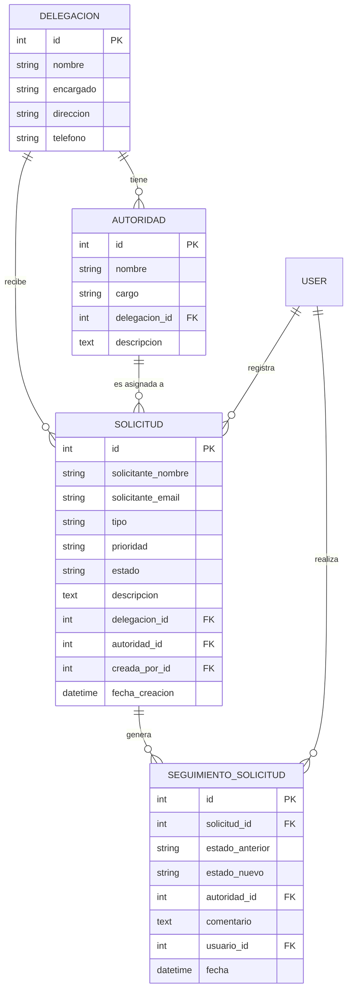
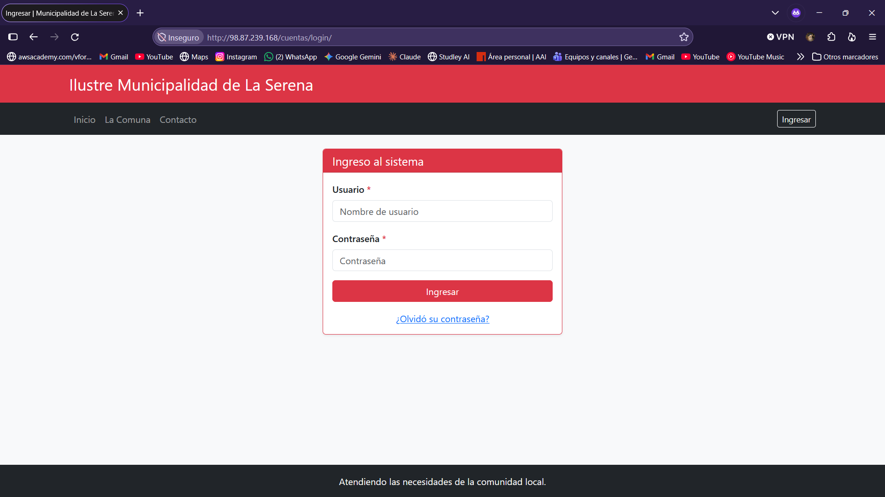
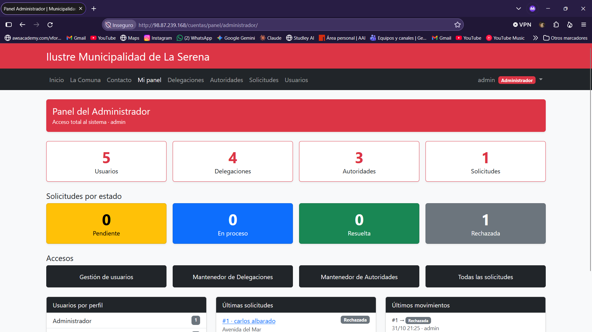
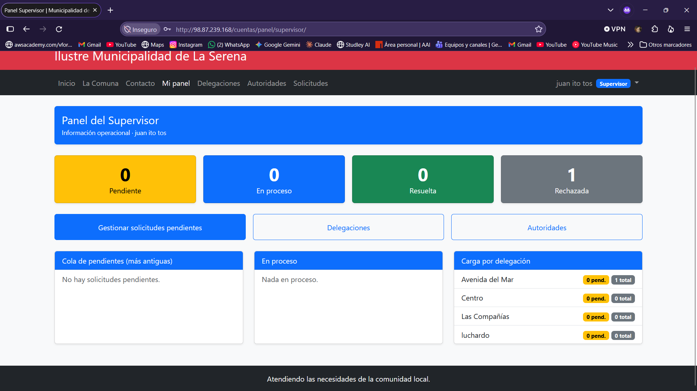
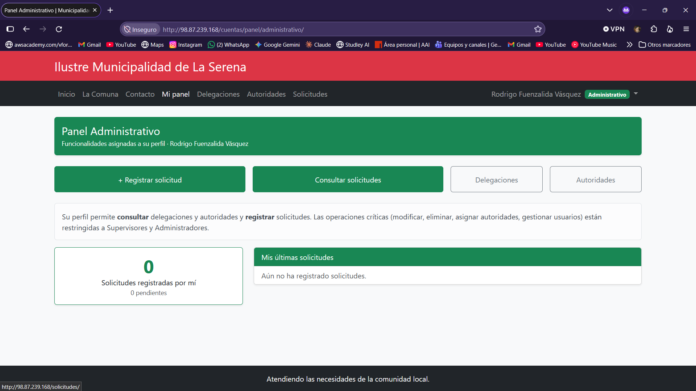
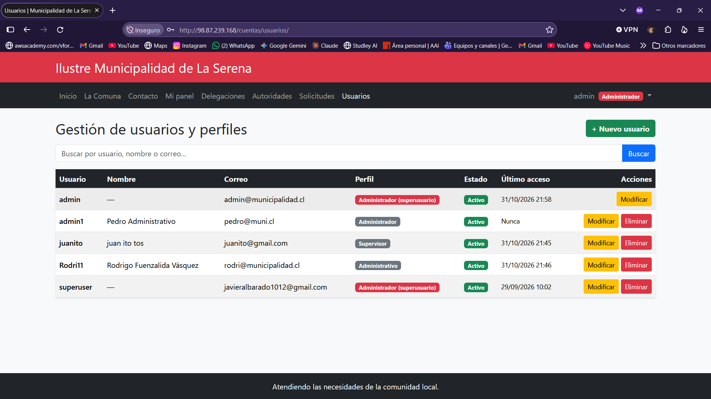
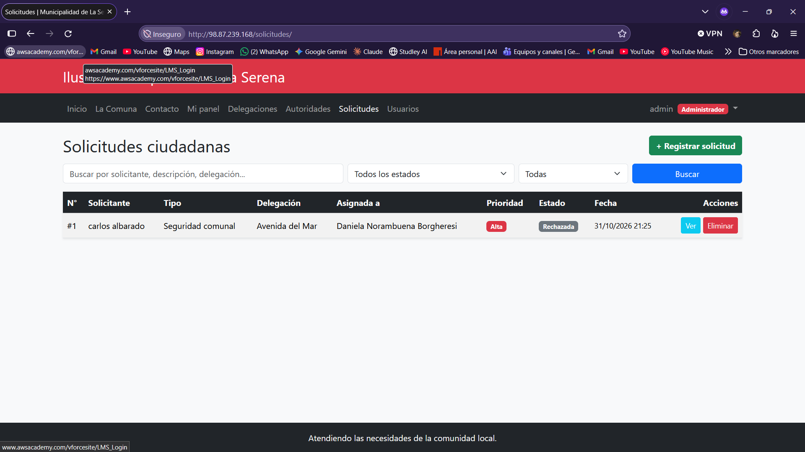

# 🏛️ Sistema Municipal de Gestión – Municipalidad de La Serena

Aplicación web desarrollada con **Django** para gestionar delegaciones territoriales, autoridades y solicitudes ciudadanas de la Ilustre Municipalidad de La Serena. Incluye autenticación con perfiles, recuperación de contraseña por correo, dashboards diferenciados por rol y mantenedores CRUD completos.

> Proyecto académico – **Programación Back End (TI3041)**, INACAP Sede La Serena
> Evolución de las Evaluaciones Sumativas 1 → 2 → 3.


---

## 📑 Contenido

- [Características](#-características)
- [Perfiles y permisos](#-perfiles-y-permisos)
- [Modelo de datos](#-modelo-de-datos)
- [Tecnologías](#-tecnologías)
- [Estructura del proyecto](#-estructura-del-proyecto)
- [Instalación local](#-instalación-local)
- [Variables de entorno](#-variables-de-entorno)
- [Despliegue en AWS EC2](#-despliegue-en-aws-ec2)
- [Recuperación de contraseña](#-recuperación-de-contraseña)
- [Pruebas automáticas](#-pruebas-automáticas)
- [Capturas](#-capturas)
- [Autor](#-autor)

---

## ✨ Características

- **Autenticación completa:** inicio y cierre de sesión, vistas protegidas y acceso restringido según perfil.
- **3 perfiles de usuario** (Administrador, Supervisor, Administrativo) con permisos diferenciados mediante grupos y permisos nativos de Django.
- **Recuperación de contraseña por correo** con token seguro, de un solo uso y con vencimiento.
- **Dashboards por rol:** cada perfil ve un panel distinto con la información y accesos que le corresponden.
- **2 mantenedores CRUD:** Delegaciones y Autoridades (crear, listar, buscar, modificar y eliminar, con validaciones y paginación).
- **Transacción operacional – Solicitudes ciudadanas:** registro, asignación de autoridad y cambio de estado con historial de seguimiento, ejecutado de forma atómica.
- **Gestión de usuarios** desde la propia aplicación (sin Django Admin).
- **Interfaz responsive** con Bootstrap 5 instalado de forma local y herencia de plantillas.
- **Configuración sensible fuera del código** mediante variables de entorno.
- **40 pruebas automáticas** que cubren autenticación, permisos, CRUD y la transacción.

---

## 👥 Perfiles y permisos

| Operación | Administrador | Supervisor | Administrativo |
|---|:-:|:-:|:-:|
| Ver delegaciones y autoridades | ✅ | ✅ | ✅ |
| Crear / modificar delegaciones y autoridades | ✅ | ✅ | ❌ |
| Eliminar delegaciones y autoridades | ✅ | ❌ | ❌ |
| Ver y registrar solicitudes | ✅ | ✅ | ✅ |
| Asignar autoridad / cambiar estado de solicitudes | ✅ | ✅ | ❌ |
| Eliminar solicitudes | ✅ | ❌ | ❌ |
| Gestión de usuarios y perfiles | ✅ | ❌ | ❌ |

Un superusuario creado con `createsuperuser` se comporta como Administrador.

### Dashboards

| Perfil | Contenido del panel |
|---|---|
| **Administrador** | Visión global: totales del sistema, usuarios por perfil, solicitudes por estado, últimos movimientos y acceso a todos los módulos. |
| **Supervisor** | Información operacional: cola de solicitudes pendientes, solicitudes en proceso y carga de trabajo por delegación. |
| **Administrativo** | Funcionalidades asignadas: registrar solicitudes, consultar y ver el estado de las propias. Operaciones críticas restringidas. |

---

## 🗄️ Modelo de datos



**Flujo de estados de una solicitud:** `Pendiente → En proceso → Resuelta` (o `Rechazada` desde Pendiente / En proceso). Las solicitudes cerradas no admiten modificaciones.

---

## 🛠️ Tecnologías

- **Backend:** Python 3.12, Django 6.1
- **Base de datos:** MySQL (SQLite opcional para desarrollo)
- **Frontend:** Django Templates, Bootstrap 5 (local)
- **Configuración:** python-decouple
- **Servidor de aplicación:** Gunicorn
- **Infraestructura:** AWS EC2 (Linux), Git y GitHub

---

## 📂 Estructura del proyecto

```
├── config/          Configuración, urls y utilidades compartidas
├── institucion/     Modelos Delegacion y Autoridad, mantenedor de autoridades, páginas públicas
├── delegaciones/    Mantenedor de delegaciones y página de contacto
├── solicitudes/     Transacción: modelos, formularios y lógica atómica (services.py)
├── cuentas/         Login, recuperación de contraseña, dashboards, usuarios y permisos
├── templates/       base.html, plantillas CRUD reutilizables y parciales
├── static/          Bootstrap local (css/js) e imágenes
├── manage.py
├── requirements.txt
└── .env.example
```

---

## 💻 Instalación local

```bash
# 1. Clonar el repositorio
git clone URL_DEL_REPOSITORIO
cd NOMBRE_DEL_REPOSITORIO

# 2. Crear y activar el entorno virtual
python -m venv venv
source venv/bin/activate          # Windows: venv\Scripts\activate

# 3. Instalar dependencias
pip install -r requirements.txt

# 4. Configurar variables de entorno
cp .env.example .env              # luego editar .env con tus valores

# 5. Crear tablas (también crea los 3 perfiles con sus permisos)
python manage.py migrate

# 6. Cargar datos iniciales y crear el administrador
python manage.py cargar_json
python manage.py createsuperuser

# 7. (Opcional) Crear un usuario de ejemplo por cada perfil
python manage.py crear_usuarios_demo --password 'TuClaveDeDemo'

# 8. Ejecutar
python manage.py runserver
```

Acceso: <http://127.0.0.1:8000/> · Login: <http://127.0.0.1:8000/cuentas/login/>

> Para desarrollar sin MySQL, define `DB_ENGINE=django.db.backends.sqlite3` en el `.env`.

---

## 🔐 Variables de entorno

Toda la configuración sensible se lee desde el archivo `.env` (no se sube al repositorio). Usa `.env.example` como plantilla.

| Variable | Descripción | Ejemplo |
|---|---|---|
| `SECRET_KEY` | Clave secreta de Django | *(cadena larga aleatoria)* |
| `DEBUG` | Modo depuración | `False` |
| `ALLOWED_HOSTS` | Hosts permitidos, separados por coma | `localhost,mi-ip` |
| `CSRF_TRUSTED_ORIGINS` | Orígenes https confiables (si aplica) | `https://midominio.cl` |
| `DB_NAME` / `DB_USER` / `DB_PASSWORD` | Credenciales de MySQL | – |
| `DB_HOST` / `DB_PORT` | Servidor y puerto de la BD | `localhost` / `3306` |
| `EMAIL_BACKEND` | Backend de correo (`console` en desarrollo) | `django.core.mail.backends.smtp.EmailBackend` |
| `EMAIL_HOST` / `EMAIL_PORT` / `EMAIL_USE_TLS` | Servidor SMTP | `smtp.gmail.com` / `587` / `True` |
| `EMAIL_HOST_USER` / `EMAIL_HOST_PASSWORD` | Cuenta SMTP (en Gmail, contraseña de aplicación) | – |
| `DEFAULT_FROM_EMAIL` | Remitente de los correos | – |
| `PASSWORD_RESET_TIMEOUT` | Vigencia del enlace de recuperación (segundos) | `3600` |
| `PASSWORD_RESET_USE_HTTPS` | Generar enlaces `https` en los correos | `False` |

---

## ☁️ Despliegue en AWS EC2

Requisitos en la instancia (Ubuntu): Python 3, `venv`, Git y MySQL.

```bash
git clone URL_DEL_REPOSITORIO && cd NOMBRE_DEL_REPOSITORIO
python3 -m venv venv && source venv/bin/activate
pip install -r requirements.txt

nano .env                         # completar las variables de entorno

python manage.py migrate
python manage.py cargar_json
python manage.py createsuperuser
python manage.py collectstatic --noinput

gunicorn config.wsgi:application --bind 0.0.0.0:8000
```

Recuerda abrir el puerto en el **Security Group** de la instancia.

**Actualizar una versión ya desplegada:**

```bash
git pull
source venv/bin/activate
pip install -r requirements.txt
python manage.py migrate
python manage.py collectstatic --noinput
# reiniciar gunicorn
```

---

## 📧 Recuperación de contraseña

Flujo implementado con el sistema de tokens de Django:

1. El usuario ingresa a **¿Olvidó su contraseña?** y escribe su correo.
2. El sistema genera un **token seguro** (HMAC, vinculado al usuario y a su contraseña actual).
3. Se envía un **correo con el enlace** de recuperación.
4. Al abrir el enlace se **valida el token** (si es inválido o venció, se informa).
5. El usuario **establece una nueva contraseña** (con las validaciones de seguridad de Django).
6. Se **confirma el cambio** y puede iniciar sesión con la nueva clave.

El token es de un solo uso y vence según `PASSWORD_RESET_TIMEOUT`. Por seguridad, el sistema no revela si un correo existe o no.

---

## ✅ Pruebas automáticas

```bash
DB_ENGINE=django.db.backends.sqlite3 python manage.py test
```

Las 40 pruebas cubren: login/logout, restricción de acceso por perfil, gestión de usuarios, flujo completo de recuperación de contraseña, CRUD de ambos mantenedores, validaciones y la transacción de solicitudes.

---

## 📸 Capturas

> Reemplaza estos marcadores por tus capturas (guárdalas en una carpeta `docs/` del repo).

| Login | Dashboard Administrador |
|---|---|
|  |  |

| Dashboard Supervisor | Dashboard Administrativo |
|---|---|
|  |  |

| Mantenedor | Gestión de solicitud |
|---|---|
|  |  |

---

## 👤 Autor

**Carlos Albarado**
Estudiante de Analista Programador – INACAP Sede La Serena
Docente: Alex Díaz Araos
